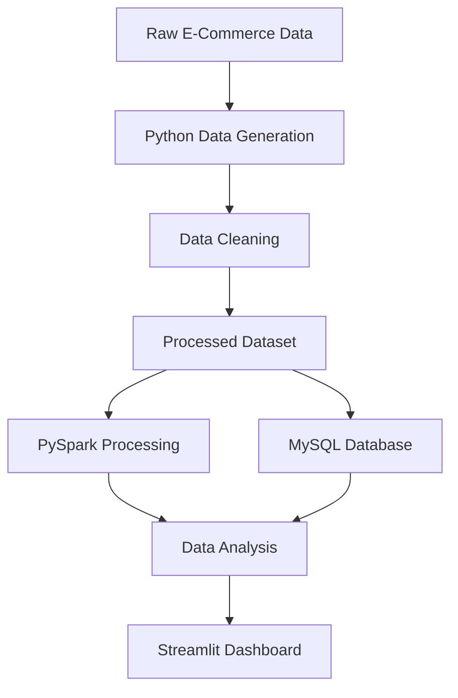

# E-Commerce Big Data Analytics Project


## Project Overview

The E-Commerce Big Data Analytics Project is designed to generate, process, store, and analyze large volumes of e-commerce sales data using Python, PySpark, and MySQL.

The project helps identify sales trends, customer purchasing patterns, product performance, and revenue insights through an interactive Streamlit dashboard.

## Objectives

- Generate realistic e-commerce sales datasets.
- Clean and preprocess raw data using Python.
- Process large datasets using Apache Spark.
- Store structured sales data in MySQL.
- Analyze business performance using data analytics.
- Visualize insights through an interactive dashboard.

## Technology Stack

| Technology | Purpose |
|---|---|
| Python | Data generation and processing |
| Pandas | Data cleaning and analysis |
| PySpark | Big Data processing |
| MySQL | Database management |
| Streamlit | Interactive dashboard |
| Git & GitHub | Version control |

## Project Architecture



## Dataset Information

The project currently uses a synthetic e-commerce dataset containing 50,000 records.

**Dataset columns:**

- Order_ID
- Order_Date
- Customer_ID
- Product
- Category
- Price
- Quantity
- City
- Payment_Method
- Total_Sales

## Project Structure

```text
ecommerce-big-data-project/
│
├── dashboard/
│   └── app.py
│
├── data/
│   ├── raw/
│   └── processed/
│
├── src/
│   ├── generate_data.py
│   ├── clean_data.py
│   ├── load_to_mysql.py
│   └── first_spark.py
│
├── .gitignore
└── README.md
```

## Key Features

- Automated dataset generation.
- Data preprocessing and cleaning.
- Large-scale data processing using PySpark.
- MySQL database integration.
- Sales and revenue analysis.
- Interactive data visualization.

## Installation and Setup

### 1. Clone the repository

```bash
git clone https://github.com/mohamedanvar-in/ecommerce-big-data-project.git
```

### 2. Navigate to the project

```bash
cd ecommerce-big-data-project
```

### 3. Create a virtual environment

```bash
python -m venv venv
```

### 4. Activate the environment (Windows)

```powershell
.\venv\Scripts\Activate.ps1
```

### 5. Install dependencies

```bash
pip install pandas numpy matplotlib streamlit pyspark mysql-connector-python
```

### 6. Run the project

Generate data:

```bash
python src/generate_data.py
```

Clean data:

```bash
python src/clean_data.py
```

Run PySpark processing:

```bash
python src/first_spark.py
```

Launch dashboard:

```bash
streamlit run dashboard/app.py
```

## Future Enhancements

- Implement automated ETL pipelines.
- Add advanced PySpark transformations.
- Develop customer segmentation.
- Implement sales forecasting using Machine Learning.
- Add interactive KPI monitoring.
- Deploy the dashboard online.

## Author

**Mohamed Anvar**

GitHub: [mohamedanvar-in](https://github.com/mohamedanvar-in)

Project: [E-Commerce Big Data Analytics](https://github.com/mohamedanvar-in/ecommerce-big-data-project)

---

*This project is continuously being improved as part of my learning journey in Data Engineering and Big Data Analytics.*
